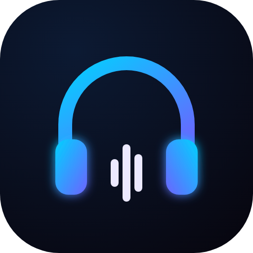
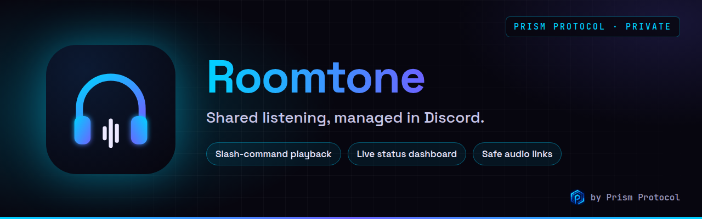
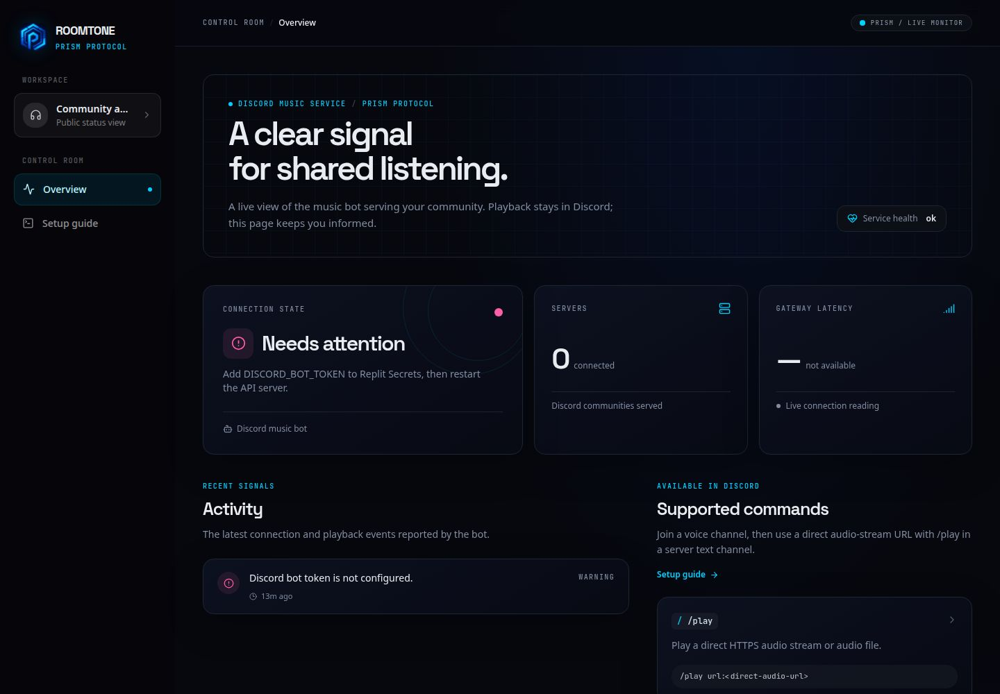

<div align="center">
  
  <br />
  
  
  <br /><br />
  <a href="https://github.com/krishyaa06/roomtone-discord-music-bot"></a>
  
  
  
  <br />
  <a href="https://krishyaa06.github.io/prism-bots-panel/#/dashboard/roomtone"></a>
  <a href="https://dc.gg/prismprotocol"></a>
</div>

<p align="center">
  
</p>

> [!NOTE]
> **Private bot for the [Prism Protocol](https://dc.gg/prismprotocol) server.** Roomtone runs our community listening sessions and is not open for public invites. Want a music bot for your own server? Try the free [Prism music bots](https://krishyaa06.github.io/prism-bots-panel/).

Roomtone is a Discord voice bot with a live, read-only dashboard for connection status, server count, latency, recent activity, and supported commands. The interface follows the dark, neon-accented Prism Protocol identity.

## Preview

The dashboard is available in this project's Replit preview. A public deployment URL has not been created yet.

<p align="center">
  
</p>

The preview shows the bot connected at capture time. The dashboard reads current connection status and activity from the API.

## Features

- Slash commands for `/play`, `/pause`, `/resume`, `/skip`, `/queue`, `/stop`, and `/leave`.
- `/play` accepts a direct HTTPS audio file or stream URL. It does not extract audio from video or music-service pages.
- The bot joins the voice channel of the person who runs `/play`.
- The dashboard displays connection status, server count, gateway latency, recent bot activity, and command usage.
- The dashboard is informational only; playback controls stay in Discord.
- Discord slash commands are registered when the bot connects. The bot does not request the privileged message-content intent.
- Audio URLs are checked before playback; local and private IPv4 destinations are rejected.
- The interface uses the Prism Protocol logo, dark terminal-inspired surfaces, cyan/violet accents, and reduced-motion-aware animation.

Only play audio that you have permission to use.

## Set up the Discord bot

1. In the [Discord Developer Portal](https://discord.com/developers/applications), create an application and add a bot.
2. Invite the bot with the `bot` and `applications.commands` scopes, plus the `Connect` and `Speak` permissions.
3. Add the bot token as a Replit Secret named `DISCORD_BOT_TOKEN`. Do not paste the token into source code, `.env`, or GitHub.
4. Restart the **API Server** workflow. The dashboard will show the live connection state once the bot connects.
5. Join a voice channel, then run `/play` in a server text channel with a direct HTTPS audio URL.

Example:

```text
/play url:https://your-audio-host.example/track.mp3
```

The URL must respond directly with audio. YouTube, Spotify, SoundCloud pages, and other page URLs are not supported.

## Run in Replit

The workspace has separate web-dashboard and API-server workflows. The API server also runs the Discord bot and uses `ffmpeg` for audio conversion. The dashboard can start without a bot token, but the bot will remain unconfigured until `DISCORD_BOT_TOKEN` is added through Replit Secrets.

## Project structure

| Path | Purpose |
| --- | --- |
| `artifacts/discord-music` | React dashboard and setup guide |
| `artifacts/api-server/src/lib/music-bot.ts` | Discord voice bot runtime |
| `artifacts/api-server/src/routes/music.ts` | Dashboard API endpoints |
| `lib/api-spec/openapi.yaml` | API contract |
| `lib/api-client-react` and `lib/api-zod` | Generated API hooks and schemas |

## Checks

```sh
pnpm run typecheck
pnpm --filter @workspace/api-server run build
```

## Prism Bots Panel

Roomtone's status also shows up in the [Prism Bots Panel](https://krishyaa06.github.io/prism-bots-panel/#/dashboard/roomtone). Set `bots.roomtone.apiUrl` in the panel's `js/config.js` to this API server's public URL (for example the Replit deployment URL). The panel reads `/api/music/status` (CORS is already enabled in the API server).

## Branding

| File | Use |
| --- | --- |
| `assets/logo.svg` / `assets/logo.png` | Logo |
| `assets/banner.png` | README / social preview (1280×400) |
| `assets/discord/avatar.png` | Discord avatar / app icon (1024×1024) |
| `assets/discord/profile-banner.png` | Discord profile banner (1360×480) |

## Configuration

See `.env.example` for configuration names. Store real credentials in Replit Secrets; never commit them to the repository.
